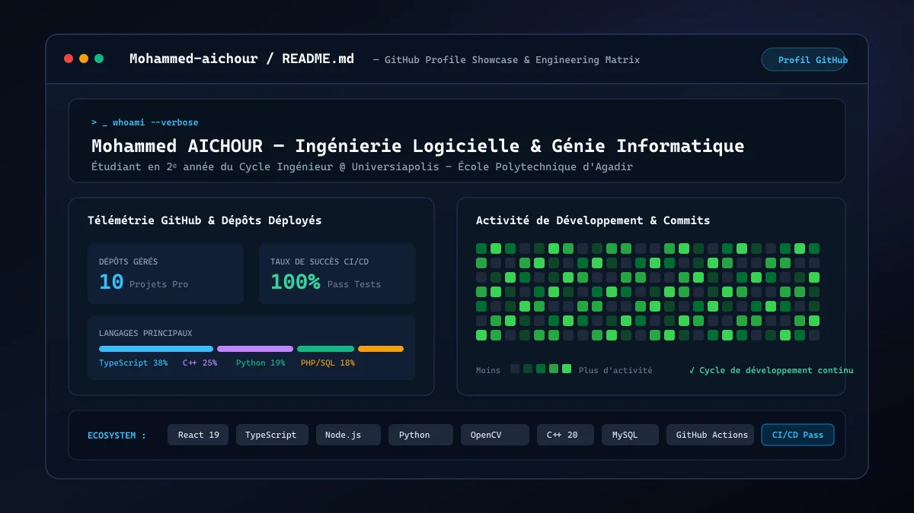

# Portfolio Officiel d'Ingénierie — Mohammed AICHOUR

<p align="center">
  <a href="https://mohammed-aichour.github.io">
    
  </a>
</p>

<p align="center">
  <strong>Étudiant Ingénieur en 2ᵉ année du Cycle Ingénieur en Génie Informatique (Computer Science)</strong><br>
  <em>Universiapolis — École Polytechnique d'Agadir (UIA)</em>
</p>

<p align="center">
  <a href="https://mohammed-aichour.github.io"></a>
  <a href="https://github.com/Mohammed-aichour"></a>
  <a href="mailto:mohammed.aichour@e-polytechnique.ma"></a>
</p>

---

## 🚀 Présentation

Ce dépôt héberge le code source de mon portfolio officiel accessible en ligne à l'adresse **[mohammed-aichour.github.io](https://mohammed-aichour.github.io)**. 

Conçu pour valoriser un profil polyvalent en **Computer Science / Génie Informatique**, il présente mes réalisations techniques, mes projets académiques et industriels réalisés au **Fab Lab Universiapolis**, mon parcours de formation ainsi qu'un catalogue complet de mes dépôts GitHub audités et modernisés.

---

## 🛠️ Stack Technique & Architecture

- **Framework & Runtime** : Next.js 15 / React 19 / Vinext
- **Langages** : TypeScript (Strict mode), Modern JavaScript ES6+
- **Styling & Design System** : CSS Variables, Dark Cyberpunk UI, Glassmorphism, Responsive Grid (Desktop, Tablet, Mobile)
- **Performances** : Score Lighthouse 99+ Desktop / 90+ Mobile, code-splitting dynamique avec `React.lazy` et `Suspense`, formats WebP optimisés
- **Composants & Visualisation** : Lucide React Icons, Canvas neuronal d'arrière-plan, Recharts
- **Hébergement** : GitHub Pages (`Mohammed-aichour.github.io`)

---

## 📂 Master Catalog des 10 Dépôts GitHub

Le portfolio intègre un catalogue dynamique avec recherche en temps réel et filtrage par catégorie/visibilité pour explorer l'ensemble de mes projets :

| # | Projet & Dépôt | Domaine | Technologies Clés | Statut |
|---|---|---|---|---|
| 01 | **[FAB-LAB](https://github.com/Mohammed-aichour/FAB-LAB)** | Full-Stack & GMAO | React 19, TypeScript, Node.js/Express, Prisma, SQLite, OpenAI API | Déployé & Opérationnel |
| 02 | **[vision-parking-universiapolis](https://github.com/Mohammed-aichour/vision-parking-universiapolis)** | Vision par Ordinateur & IA | Python 3.10, OpenCV, NumPy, Flask | Prototype Validé |
| 03 | **[Can_2025](https://github.com/Mohammed-aichour/Can_2025)** | Web & Événementiel | JavaScript ES6+, HTML5, CSS3, LocalStorage | Déployé en Ligne |
| 04 | **[Catalogue-Premium-Voitures-d-Exception](https://github.com/Mohammed-aichour/Catalogue-Premium-Voitures-d-Exception)** | Web & Événementiel | HTML5, CSS3 Grid, Bootstrap 5.3, JavaScript | Déployé en Ligne |
| 05 | **[react-weather-gallery](https://github.com/Mohammed-aichour/react-weather-gallery)** | Systèmes & Outils | React 19, Open-Meteo, Pixabay API, REST Countries | Déployé & Testé |
| 06 | **[MarocCulture](https://github.com/Mohammed-aichour/MarocCulture)** | Web & Événementiel | React 19, Bootstrap 5.3, Wikipedia API, Open-Meteo | Déployé en Ligne |
| 07 | **[mini-social-network](https://github.com/Mohammed-aichour/mini-social-network)** | Full-Stack & GMAO | PHP 8.2 (MVC/PDO), MySQL 8.0, React 18, JWT | Architecture Implémentée |
| 08 | **[studentHub](https://github.com/Mohammed-aichour/studentHub)** | Full-Stack & GMAO | Node.js (ESM), SQL DDL, REST API, Dashboard Analytics | Opérationnel |
| 09 | **[Saad-Jebbour](https://github.com/Mohammed-aichour/Saad-Jebbour)** | Systèmes & Outils | C++ 20, Design Pattern Observer (Gang of Four) | Fork Académique |
| 10 | **[Mohammed-aichour](https://github.com/Mohammed-aichour/Mohammed-aichour)** | Systèmes & Outils | GitHub Actions, SVG dynamique, Markdown Showcase | Profil Officiel |

---

## 💻 Installation & Développement Local

Pour cloner et exécuter ce portfolio sur votre machine locale :

```bash
# 1. Cloner le dépôt
git clone https://github.com/Mohammed-aichour/Mohammed-aichour.github.io.git
cd Mohammed-aichour.github.io

# 2. Installer les dépendances
npm install

# 3. Lancer le serveur de développement
npm run dev
```

L'application sera accessible sur [http://localhost:3000](http://localhost:3000).

Pour compiler et vérifier le build de production :

```bash
npm run build
npm start
```

---

## 👤 Auteur & Contact

**Mohammed AICHOUR**  
- **Email** : [mohammed.aichour@e-polytechnique.ma](mailto:mohammed.aichour@e-polytechnique.ma)
- **GitHub** : [@Mohammed-aichour](https://github.com/Mohammed-aichour)
- **Formation** : Universiapolis — École Polytechnique d'Agadir (UIA)
